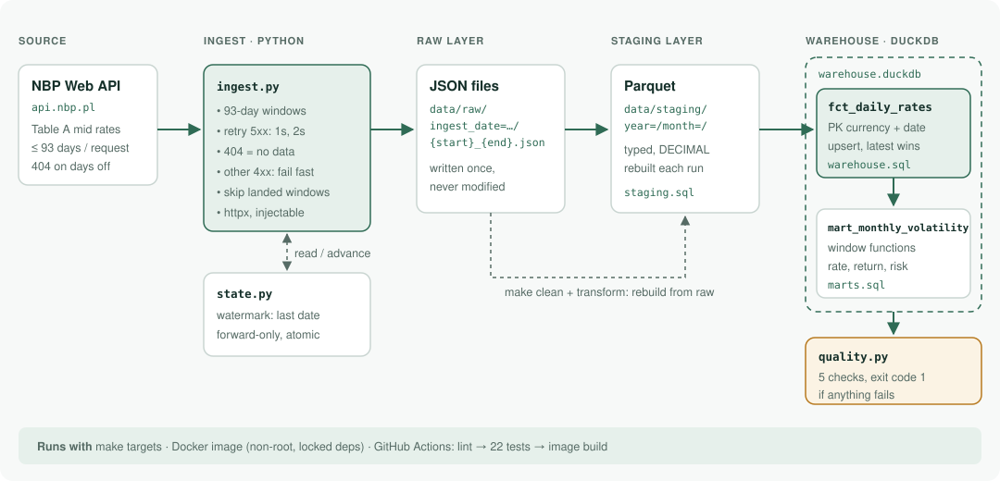
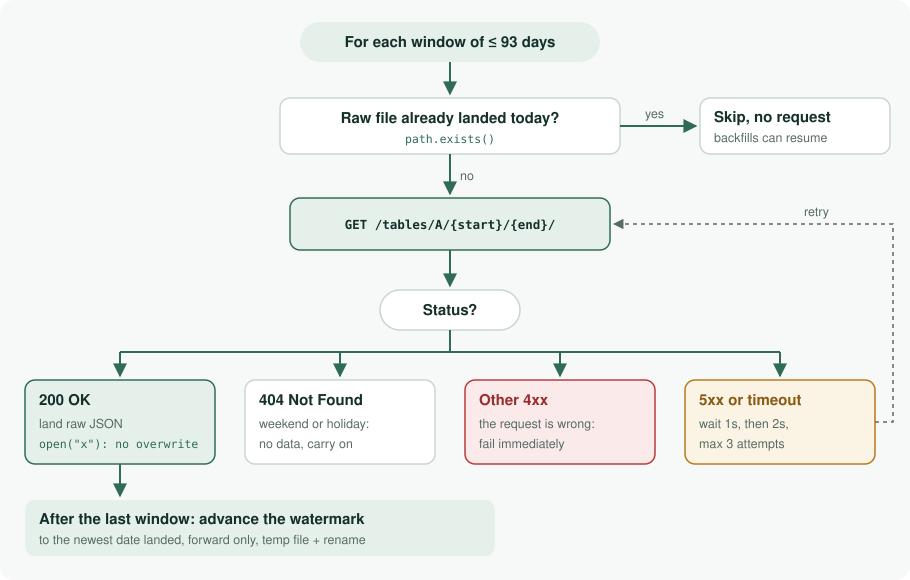
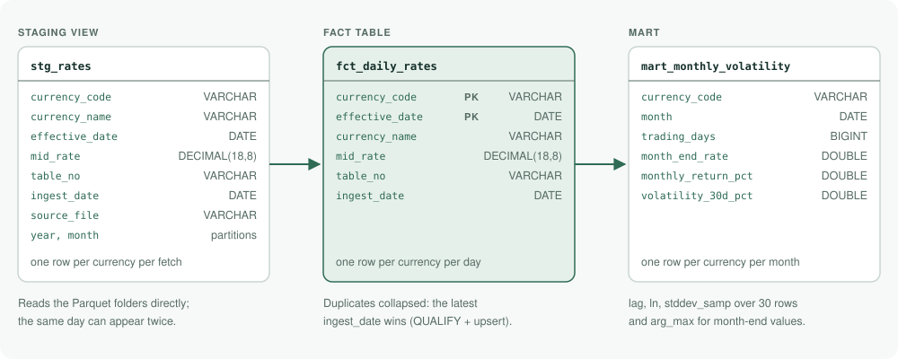
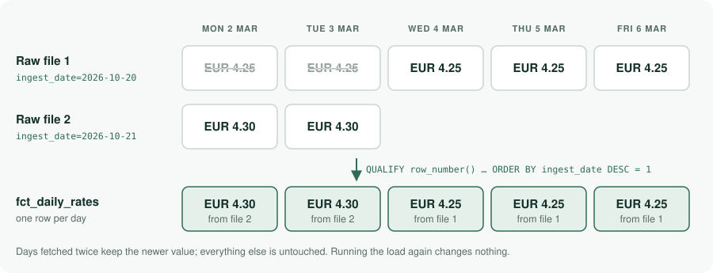
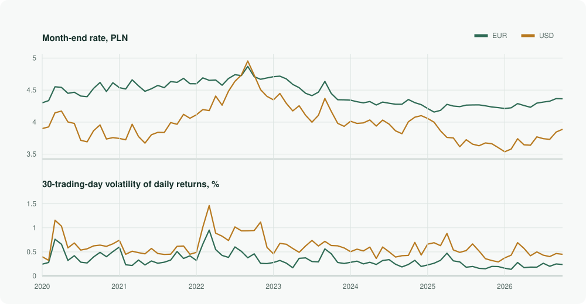

# NBP exchange-rate warehouse

[](https://github.com/SyNikolai/nbp-rates/actions/workflows/ci.yml)


An end-to-end data pipeline that collects the official daily exchange rates
published by the National Bank of Poland (NBP), stores every API response
untouched, and turns them into a clean, tested DuckDB warehouse with a
volatility analysis on top.

It covers every business day since January 2020, about 58,000 rows, and the
whole warehouse can be rebuilt from the stored raw files in seconds.

## What this project demonstrates

| Skill | Where to look |
|---|---|
| Incremental, idempotent ingestion with a watermark | [`ingest.py`](src/nbp_pipeline/ingest.py), [`state.py`](src/nbp_pipeline/state.py) |
| Resilient API client: retries, backoff, error handling by type | `fetch_table` in [`ingest.py`](src/nbp_pipeline/ingest.py) |
| Layered storage: immutable raw, staging, warehouse | [`data/` layout](#architecture) |
| Columnar storage and partitioning (Parquet) | [`sql/staging.sql`](sql/staging.sql) |
| Deduplication and upserts with a primary key | [`sql/warehouse.sql`](sql/warehouse.sql) |
| Analytical SQL with window functions | [`sql/marts.sql`](sql/marts.sql) |
| Data quality checks as code | [`quality.py`](src/nbp_pipeline/quality.py) |
| Testing without network access: mocks, dependency injection | [`tests/`](tests) |
| Containers and CI | [`Dockerfile`](Dockerfile), [`ci.yml`](.github/workflows/ci.yml) |

## Architecture



Data moves left to right through three layers, each with one job:

1. **Raw** keeps exactly what the API returned, as JSON files that are written
   once and never changed. It is the single source of truth.
2. **Staging** is the same data with proper types (dates, exact decimals),
   stored as Parquet files split into one folder per month.
3. **Warehouse** is a DuckDB database with one clean row per currency per day,
   plus a monthly analysis table built on top of it.

Because staging and the warehouse are derived from raw, they can be deleted
and rebuilt at any time without calling the API again. That makes bugs cheap
to fix: correct the SQL, rebuild, done.

## How it works

### 1. Ingestion: getting data from the API safely



The NBP API only allows 93 days per request, so a long range such as
"2020 to today" is split into windows of at most 93 days. Each window then goes
through the decision flow above. The heart of it is `fetch_table`:

```python
for attempt in range(1, attempts + 1):
    try:
        response = client.get(url, params={"format": "json"})
        if response.status_code == 404:
            return []  # weekend or holiday: no table, not an error
        response.raise_for_status()
        return response.json()
    except (httpx.TransportError, httpx.HTTPStatusError) as exc:
        retryable = isinstance(exc, httpx.TransportError) or (
            exc.response.status_code >= 500
        )
        if not retryable or attempt == attempts:
            raise
        sleep(2 ** (attempt - 1))  # wait 1s, then 2s
```

What this shows:

- **Errors are handled by type, not all the same way.** A timeout or a 5xx
  error is the server's problem and may pass, so it is retried with growing
  pauses (exponential backoff). Any other 4xx error means the request itself
  is wrong, and retrying would only repeat the mistake, so it fails at once.
- **A 404 is expected, not a failure.** NBP publishes nothing on weekends and
  holidays and answers 404, so that means "no data for these days".
- **`sleep` is passed in as a parameter.** In production it is `time.sleep`;
  in tests it is a function that records the pauses without waiting, so the
  retry logic is tested in milliseconds.

Each successful response is saved to
`data/raw/ingest_date=YYYY-MM-DD/{start}_{end}.json` using Python's
`open(path, "x")`. The `"x"` mode makes the operating system refuse to
overwrite an existing file, so the raw layer is protected by more than good
intentions. If a window is already on disk, it is skipped without a request,
which means a long backfill that crashes halfway simply continues on the
next run.

### 2. The watermark: only fetching what is new

`data/state.json` stores the last date that was loaded. `make ingest` reads it
and asks the API only for the days after it.

```python
def advance_watermark(candidate: date, path: Path = STATE_PATH) -> date:
    current = read_watermark(path)
    if current is not None and candidate <= current:
        return current  # never move backwards
    tmp = path.with_suffix(".tmp")
    tmp.write_text(json.dumps({"last_loaded_date": candidate.isoformat()}) + "\n")
    tmp.replace(path)  # atomic: all or nothing
    return candidate
```

Two details matter here. The watermark **only moves forward**, so loading old
history later cannot trick the next run into re-downloading years of data.
And the file is written **atomically**: the new value goes to a temporary file
which is then renamed over the old one. A rename either happens completely or
not at all, so a crash can never leave a half-written state file. Databases use
the same technique.

### 3. Staging: from raw JSON to typed Parquet (SQL)

```sql
COPY (
    SELECT
        rate.code                         AS currency_code,
        CAST(t.effectiveDate AS DATE)     AS effective_date,
        CAST(rate.mid AS DECIMAL(18, 8))  AS mid_rate,
        ...
    FROM read_json('data/raw/*/*.json', format = 'array', filename = true, ...) AS t,
         unnest(t.rates) AS u(rate)
) TO 'data/staging' (FORMAT parquet, PARTITION_BY (year, month));
```

In plain terms:

- `read_json` reads every raw file at once. Each file holds a list of daily
  tables, and each table holds a list of about 30 currencies.
- `unnest` flattens that nesting into one row per currency per day.
- Rates are cast to `DECIMAL(18, 8)`, an exact number type, instead of a
  floating-point number. Money should never pick up rounding errors, and some
  rates are as small as 0.00024567.
- `PARTITION_BY (year, month)` writes one folder per month. A query that only
  needs March 2024 reads only that folder instead of the whole dataset.

### 4. Warehouse: one row per currency per day (SQL)



Sometimes the same day is fetched twice, for example when a backfill overlaps
a daily run, or when NBP publishes a correction. The fact table must still
hold exactly one row per currency per day, and it must hold the newest value.



```sql
INSERT INTO fct_daily_rates
SELECT currency_code, currency_name, effective_date, mid_rate, table_no, ingest_date
FROM stg_rates
QUALIFY row_number() OVER (
    PARTITION BY currency_code, effective_date
    ORDER BY ingest_date DESC, source_file DESC
) = 1
ON CONFLICT (currency_code, effective_date) DO UPDATE SET
    mid_rate = excluded.mid_rate,
    ...
```

Reading it from the inside out:

- `row_number() OVER (PARTITION BY currency, date ORDER BY ingest_date DESC)`
  numbers the copies of each currency-day, newest first.
- `QUALIFY ... = 1` keeps only the newest copy.
- The table has a primary key on (currency, date), so a duplicate is
  impossible. `ON CONFLICT DO UPDATE` turns the insert into an **upsert**:
  new days are added, existing days are updated.

The result is that running the load once or ten times gives the same table.
The warehouse load runs inside a single transaction, so if any step fails,
nothing is half-written.

### 5. The analysis: volatility with window functions (SQL)

The mart answers a simple question per currency and month: where did the rate
end, how much did it move, and how jumpy was it?

```sql
lag(rate) OVER (PARTITION BY currency_code ORDER BY effective_date) AS prev_rate

CASE WHEN rate > 0 AND prev_rate > 0 THEN ln(rate / prev_rate) END AS log_return

stddev_samp(log_return) OVER (
    PARTITION BY currency_code ORDER BY effective_date
    ROWS BETWEEN 29 PRECEDING AND CURRENT ROW
) AS vol_30d

arg_max(rate, effective_date)       AS month_end_rate,
exp(sum(log_return)) - 1            AS monthly_return
```

- `lag` looks one row back, to yesterday's rate for the same currency.
- `ln(today / yesterday)` is the **log return**, the daily change in a form
  that can be added up across days.
- `stddev_samp` over the last 30 rows is the **30-day volatility**: how much
  the rate typically moves per day. Higher means riskier.
- `arg_max(rate, effective_date)` picks the rate on the latest date of the
  month, and `exp(sum(...)) - 1` turns the summed daily log returns back into
  the month's total change.

### 6. Data quality: the pipeline checks itself

After every load, `make check` runs five SQL checks. Each one counts
violations, and any count above zero makes the command exit with an error, so
CI or a scheduler sees the failure.

| Check | Why it matters |
|---|---|
| Fact table is not empty | catches a silent failed load |
| One row per currency per day | catches broken deduplication |
| All rates are positive | catches corrupt source data |
| Latest table is at most 7 days old | catches a pipeline that stopped running |
| No gap longer than 7 days between tables | catches missing history |

The 7-day limit is deliberate. Since 2025, Christmas Eve is a public holiday
in Poland, so Christmas plus a weekend can leave six days without any table.
A tighter limit would raise a false alarm every December, and false alarms
teach people to ignore alerts.

## Results



<!-- RESULTS:START -->
| Month | EUR month-end | EUR monthly return | EUR 30-day volatility |
|---|---:|---:|---:|
| 2026-10 | 4.3641 | -0.07% | 0.238% |
| 2026-09 | 4.3672 | +0.94% | 0.249% |
| 2026-08 | 4.3264 | +0.32% | 0.201% |
| 2026-07 | 4.3128 | +0.38% | 0.264% |
| 2026-06 | 4.2963 | +1.51% | 0.182% |
| 2026-05 | 4.2322 | -0.63% | 0.183% |
<!-- RESULTS:END -->

The chart and table are generated from the warehouse by
[`scripts/render_results.py`](scripts/render_results.py), so they always match
the data.

## Testing

22 tests, no network access, under a second. The API is replaced with
`httpx.MockTransport`, and every test writes to a temporary folder.

| Test file | What it proves |
|---|---|
| `test_ingest.py` | date windows have no gaps or overlaps; 404 means no data; 5xx is retried with 1s and 2s pauses; 400 fails at once; re-running ingest makes no new requests |
| `test_state.py` | the watermark starts empty, moves forward and never moves back |
| `test_transform.py` | transform is idempotent; a full rebuild from raw gives identical results; a republished rate replaces the old one; each quality check catches what it should |
| `test_cli.py` | `check` exits with 0 on success and 1 on failure |

## Run it

Requires [uv](https://docs.astral.sh/uv/) and `make`.

```bash
git clone https://github.com/SyNikolai/nbp-rates.git
cd nbp-rates
uv sync
make backfill      # history from 2020-01-01 (use FROM=YYYY-MM-DD to change)
make transform     # build staging and the warehouse
make check         # run the quality checks
```

After that, `make ingest transform check` brings it up to date. Run `make` on
its own to list every command.

With Docker:

```bash
docker build -t nbp-rates .
docker run --rm -v "$PWD/data:/app/data" nbp-rates
```

The image installs the exact versions in `uv.lock`, leaves test tools out, and
runs as a non-root user. Dependencies are installed before the code is copied,
so code changes rebuild in seconds.

**CI:** every push and pull request runs lint and tests on GitHub Actions; the
Docker image is built only after they pass. The workflow has read-only access
to the repository.

## Project layout

```
src/nbp_pipeline/
    ingest.py        fetch, retry, split into windows, save raw JSON
    state.py         watermark
    transform.py     runs the SQL files in order
    quality.py       data quality checks
    cli.py           ingest | backfill | transform | check
sql/
    staging.sql      raw JSON -> typed, partitioned Parquet
    warehouse.sql    staging view, fact table, upsert
    marts.sql        monthly volatility with window functions
tests/               22 tests
scripts/             renders the results chart and table
docs/                diagrams used in this README
```

## Lesson learned

A test that fed the pipeline a rate of zero did not fail where expected. It
crashed the volatility calculation (`ln(0)`) before the quality checks could
report the bad value. The fix was to make the mart skip undefined returns and
leave the reporting to the checks, so bad data now produces a clear failed
check instead of a stack trace. Testing with deliberately bad data is how this
was found.

## Next steps

- Run the pipeline daily on a schedule and alert on failed checks.
- Deploy it as a Kubernetes CronJob on my k3s homelab.

## Data source and license

Exchange rates from the public API of Narodowy Bank Polski (table A, average
rates). Code under the MIT license.
